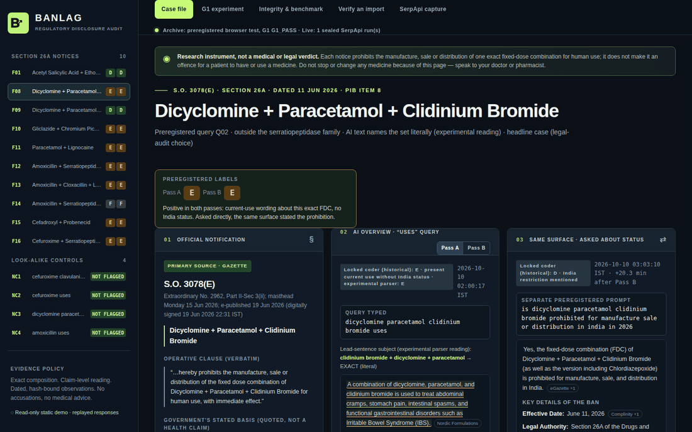
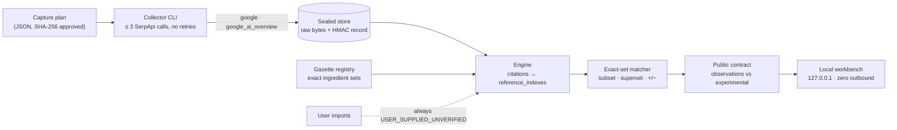
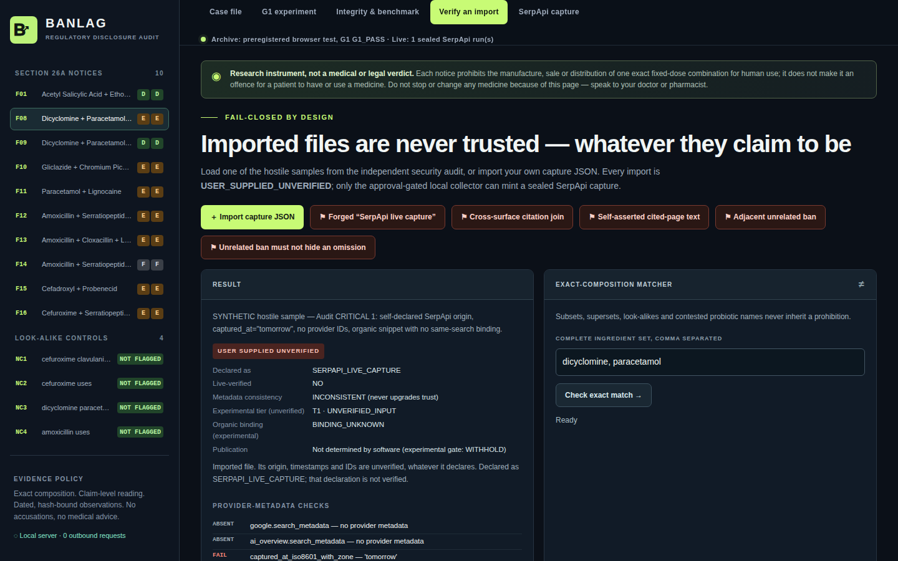

# BANLAG — Auditing AI Search Against India's Drug Regulations

[](https://github.com/aishwaryadewangan15-wq/banlag/actions/workflows/ci.yml)   [](LICENSE)

**When Google's AI cites a source about a banned drug combination, does that source describe the same combination?**

*SerpApi India Hackathon 2026 · local-first research workbench · reproducible, hash-bound evidence*

**[▶ Open the live read-only demo](https://aishwaryadewangan15-wq.github.io/banlag/)** · or run it yourself in one command (see [Quick start](#quick-start)).



## The finding in 30 seconds

- In June 2026, India banned sixteen exact fixed-dose drug combinations, each in its own Gazette notice. **One extra ingredient means a different notice:** F08 (S.O. 3078(E)) is Dicyclomine + Paracetamol + Clidinium Bromide, and F09 (S.O. 3071(E)) adds **Chlordiazepoxide**.
- In a real SerpApi capture for F08, the AI Overview's prohibition-related statement cites references [1] and [2]. **Reference [2] names the four-ingredient F09 set, a typed difference of `+chlordiazepoxide`.** Reference [1] is truncated, so BANLAG leaves it unresolved.
- BANLAG makes that ingredient-level gap visible, statement by statement, with every observation tied to hashed provider data. It never declares a winner it can't prove.

## How it works



| Piece | What it does |
|---|---|
| **Collector** (`banlag/collector.py`) | Runs only a plan whose SHA-256 you approved twice (CLI flag and env var). Hard cap of 3 calls, no retries, and the API key is never stored or logged. |
| **Sealed store** (`banlag/capture_store.py`) | Keeps raw provider bytes, SHA-256 bound and HMAC-sealed with a machine-local key. The store refuses keys inside the project or synced folders. |
| **Engine and citations** (`banlag/engine.py`, `banlag/citations.py`) | Links each AI Overview text block to the references its `reference_indexes` point at. Duplicate or malformed indexes are disclosed, never guessed. |
| **Exact-set matcher** (`banlag/legal.py`) | Only a complete ingredient set matches a notice. Subsets, supersets and look-alikes never inherit a ban, and unknown names make it abstain. |
| **Public contract** (`banlag/public.py`) | An allowlist: only observed, registered and mechanical fields are public. Parser readings go under `experimental`. |
| **Workbench** (`banlag/server.py`, `web/`) | Standard-library HTTP server bound to 127.0.0.1, with DNS-rebinding and cross-site protection, a strict CSP and hash-checked screenshots. |

## The real SerpApi case: F08

The archived run from 10 October 2026 made three successful SerpApi calls: a Google Search for the formulation's uses, its AI Overview `page_token` follow-up, and a separate search about the formulation's status.

![Mechanical observations for the F08 capture: reference [2] names the F09 set](docs/assets/citations.png)

- The AI Overview noted that India had prohibited certain fixed-dose combinations with anticholinergic ingredients. That's a **partial, class-level disclosure**, not a demonstrated omission.
- Its prohibition-related block cites **[1]** and **[2]** via SerpApi's `reference_indexes`.
- Reference **[2]** names four ingredients, including Chlordiazepoxide, which gives a **candidate** match to **F09 / S.O. 3071(E)**, `+chlordiazepoxide` against the F08 target.
- Reference **[1]** is truncated, so its formulation stays **unresolved**.

**What this shows:** a meaningful formulation difference made visible at the level of one AI statement and its captured citations. **What it doesn't show:** that Google concealed anything, that either source page is wrong, or that a live omission was verified. See [Limitations](#limitations).

The capture is preserved at [`evidence/serpapi/run-20261010T024515Z-9415e2/`](evidence/serpapi/run-20261010T024515Z-9415e2/): three collector records, their raw provider responses and a SHA-256 export manifest.

## Earlier preregistered browser study

Before the SerpApi capture, ten exact formulations were searched on signed-out Google India, with the query design and coding rules locked before the first query.

- In **7 of 10** compositions, the single-coder labels recorded present-use descriptions without India-specific regulatory context in both passes. When asked about status directly, the same surface described the restrictions.
- One literal notice-number discrepancy was preserved: the AI cited **S.O. 3080(E)**, while the Gazette notice for Paracetamol + Lignocaine is **S.O. 3079(E)**. That's a string comparison, not a claim about intent.

## Why SerpApi is essential

SerpApi returns the AI Overview as structured `text_blocks` with `reference_indexes` into its `references`, so BANLAG can tell which cited source belongs to which statement instead of guessing from visual source chips. BANLAG uses `google` with `gl=in` for India-targeted results, and `google_ai_overview` for the `page_token` follow-up.

## Quick start

Requirements: Python 3.10 or newer. No dependencies, and no API key needed to explore.

```bash
git clone https://github.com/aishwaryadewangan15-wq/banlag.git
cd banlag
python -m banlag            # then open http://127.0.0.1:8765
```

Or install it as a command (editable, so the bundled UI and evidence stay in place):

```bash
pip install -e .
banlag
```

Run the tests with `python -m unittest discover -s tests`. On Windows you can double-click `RUN_WINDOWS.bat`.

The workbench makes **no outbound requests**. New captures happen only through the separate collector, after you approve the exact plan:

```bash
python -m banlag.collector plans/first_feasibility_probe.json --dry-run   # exact requests, no network
```

A fresh clone replays the exported run as `ARCHIVED_SERPAPI_CAPTURE`: its hashes are consistent, but the origin can't be authenticated without the private sealing key, which is deliberately never published. Details are in [docs/CAPTURE_SCHEMA.md](docs/CAPTURE_SCHEMA.md).

## Guided demo

1. Open case **F08** and inspect Gazette notice S.O. 3078(E).
2. Scroll to the archived SerpApi AI Overview.
3. In **Mechanical observations**, inspect the prohibition-related block and references [1] and [2].
4. Compare the F09 candidate and its extra chlordiazepoxide.
5. Open **G1 experiment** for the browser study and its single-coder limits.
6. Open **Integrity & benchmark** for the S.O. 3080(E) vs S.O. 3079(E) discrepancy.
7. Open **Verify an import**: every hostile sample stays `USER_SUPPLIED_UNVERIFIED`.



## Limitations

BANLAG is an evidence exploration instrument, not an automated legal or medical decision-maker. Each limit is stated once, here:

- **One capture run.** The SerpApi evidence is a single run, at one time and one location. AI Mode was not captured, and the status search's AI Overview was not fetched. No verified live omission and no live Tier 2/3 finding was established.
- **Cited pages were not fetched.** Observations are about captured citation *metadata*. An ingredient-name match in a snippet doesn't prove the snippet lists every ingredient.
- **The parser is experimental.** The English parser uses bounded rules with known failure modes, and it has no independently measured accuracy. Its labels, tiers and readings are marked experimental for human review.
- **Coverage.** The registry covers 10 of the 16 notifications. The browser study is single-coder, not independently recoded, and not a representative estimate of Google's accuracy.
- **Contract scope.** The public contract recursively filters assessment and evidence routes. Registry, exact-match and status routes are typed pass-throughs ([docs/PUBLIC_CONTRACT.md](docs/PUBLIC_CONTRACT.md)).
- **Legal status.** No amendment or stay was found as of 10 October 2026, but those searches weren't exhaustive. Recheck before any regulatory use.
- **No accusations.** BANLAG makes no claims about Google, publishers, pharmacies, manufacturers or products, and it does not explain why an AI produced an answer.
- **Engineering tests are not accuracy.** CI runs 265 regression, adversarial and property tests. They verify behaviour, not general-language classification accuracy.

> **Medical safety:** Do not start, stop or change any medication based on BANLAG. A Gazette ban on manufacture, sale or distribution does not by itself make a patient's possession or use an offence. Speak to a doctor or pharmacist.

## Reproducibility and release identity

The commit submitted to the SerpApi India Hackathon 2026 is `063a0d1c93ff24e973b4dbacab3d6f439542a653`. It stays permanently reachable, together with its source fingerprint (`c635055d573cea07146c68b9a9fb89ddd06bdf1a698ca242b63bf02d7d048f73`) and the method behind it, on the [`engineering-history`](https://github.com/aishwaryadewangan15-wq/banlag/tree/engineering-history) branch. The audit rounds are summarised in [docs/ENGINEERING_HISTORY.md](docs/ENGINEERING_HISTORY.md).

Every change since is tested in CI on Python 3.10–3.13 across Linux, Windows and macOS. See [CHANGELOG.md](CHANGELOG.md).

## Development and prior art

BANLAG was built with AI assistance: Claude Code for implementation, ChatGPT for planning and review, and OpenAI Codex for adversarial audits. Prior work such as GRAP Audit also examines citation relationships. BANLAG's focus is the exact ingredient-level distinction between Indian Gazette notifications. Contributions are welcome; see [CONTRIBUTING.md](CONTRIBUTING.md).

## Official sources

- [Gazette of India — S.O. 3068(E)–3083(E)](https://egazette.gov.in/WriteReadData/2026/273649.pdf)
- [Press Information Bureau release](https://www.pib.gov.in/PressReleasePage.aspx?PRID=2275595)
- [Central Drugs Standard Control Organisation](https://cdsco.gov.in/opencms/opencms/en/Drugs/FDC/)
- [SerpApi Google AI Overview API](https://serpapi.com/google-ai-overview-api)

## License and citation

Code is released under the [MIT License](LICENSE). BANLAG's own annotations, registry and corpus coding are released under [CC BY 4.0](LICENSE-DATA.md). Third-party material in `evidence/` (captured search results, screenshots and quoted source text) remains the property of its owners and is included for research and verification only. To cite BANLAG, see [CITATION.cff](CITATION.cff).
